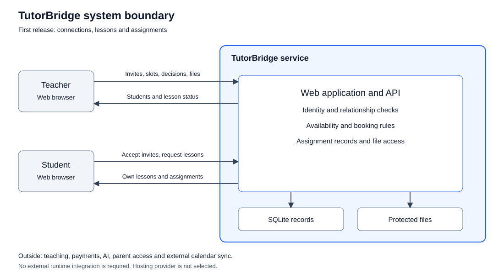

# Project Proposal and System Vision: TutorBridge

## 1. Problem and expected value

Teachers need time to teach, prepare lessons and manage their students. Students need lesson times that fit their schedules and a clear place to find homework. TutorBridge brings these tasks into one web application for private tutors and their existing students.

Our starting assumption is that separate messages, calendars and shared files make changes hard to track. A lesson update can be missed, or a homework file can be difficult to find. We have not interviewed users yet, so the frequency and time cost are not measured.

[OECD TALIS 2024](https://www.oecd.org/en/publications/results-from-talis-2024_90df6235-en/full-report/the-demands-of-teaching_0e941e2f.html) reports that about half of teachers across OECD education systems identify excessive administrative work as a source of stress. This is school-teacher evidence. It does not prove the same problem exists for our private-tutor users.

Toprak and Arda will ask tutors and students how they arrange lessons, handle changes and share homework. They will record real examples and use the findings to revise the scope.

## 2. Users and stakeholders

| Group | Need and role |
|---|---|
| Teachers | Manage current students, availability, lesson requests and homework. Primary user and workflow decision maker. |
| Students | Find available times, request lessons and access their own assignments. Primary user. |
| Team | Agree the scope, build the system and maintain its records. Product owner and operator. |
| Hosting provider, when selected | Supply hosting and storage within its limits. External infrastructure dependency. |
| Course staff | Review the project, workflow and individual contributions. Assessment stakeholder. |

Parents may use a later version. They do not have an account in the first release.

## 3. Proposed solution and first release

1. A teacher invites an existing student. The student accepts and becomes connected to that teacher.
2. The teacher publishes lesson slots. A connected student requests one; the teacher approves or rejects it.
3. The teacher assigns a PDF or image. The student can view and download their own assignment.

The first release also includes registration, login, personal lesson lists, permitted cancellations and removal of unused slots. Only the relevant teacher and student can access their private records.

Outside this release: AI question generation, parent access, teacher discovery, payments, video, chat, external calendar sync, native mobile apps and advanced analytics. Homework submission and feedback can be considered later.

## 4. Feasibility, assumptions and risks

| Area | Plan |
|---|---|
| Technology | HTML, CSS and JavaScript; Node.js with Express; SQLite. This is a small course application. The backend is not implemented yet. |
| Skills and schedule | Six members share the work in the RACI plan. The backlog contains initial estimates and dependencies. The team still needs to confirm capacity. |
| Data and integration | Use test or authorized data. Store files outside the public web directory. No external AI, email or calendar service is needed. |
| Operations and cost | Start locally without a paid service. Select hosting, storage limits and backups before deployment. SQLite suits a small deployment; concurrent approvals need transactional tests. |
| Legal and ethical limits | Protect student information and file access. Share learning materials only with permission. Check dependency licenses before implementation. |

Assumptions: users have a browser and internet access; teachers bring their existing students; each account is a teacher or student; a student may connect to several teachers. The evaluation dataset is small.

| Risk | Mitigation | Owner |
|---|---|---|
| Double booking | Check and approve in one transaction; test simultaneous requests | Mehmet Ali, Berat |
| Access to another student's records | Check role, relationship and ownership on the server | Mehmet Ali, Berat |
| Unsafe or large files | Permit PDF/JPEG/PNG up to 10 MiB; authorize downloads | Osman Berke, Kemal Efe |
| Too much scope or uneven work | Use small Issues, clear owners and reviewed PRs | Toprak, Arda |
| Wrong assumptions about users | Collect actual tutor/student examples before claiming benefits | Toprak, Arda |

## 5. Success criteria and license

Targets, not completed results:
- A logged-in, connected student can request a lesson within two minutes in a usability task.
- A teacher cannot have overlapping approved lessons, including concurrent approval attempts.
- A student cannot retrieve another student's assignment or file.
- A teacher can assign a permitted file and the student can retrieve it.

We chose [MIT](../LICENSE.md) because it is a short, permissive license that allows others to reuse and extend the code with the required notice. It does not make uploaded student data or learning materials public.

## 6. System vision and boundary

The system manages relationships, lesson requests and assignments. Teachers conduct lessons and make academic decisions outside the application. Payment collection and live lesson delivery are also outside it.

The arrows show the information exchanged. Human actors and browsers are outside the service boundary. The application, database and protected file storage are inside. There is no required external runtime API in the MVP. Update the diagram if a hosted identity, storage or notification service is later selected.

## 7. Main rules and constraints

- Protected actions require a valid token plus server-side role and ownership checks.
- Invitations match one student email, expire after seven days and are single-use.
- A student can request lessons only from a connected teacher. The booking uses the selected slot's stored times.
- Requests start as `pending`. Pending requests do not hold a slot exclusively. Only the teacher approves or rejects them.
- Approval rechecks availability and overlaps in one transaction. Adjacent lessons are allowed; overlapping approved lessons are not.
- Either participant can cancel a pending/approved booking before it starts. Rejected and cancelled states are final.
- A slot with pending or approved bookings cannot be removed until permitted bookings are cancelled.
- Teachers assign files only to connected students. Only that teacher and assigned student can retrieve them.
- Use PDF/JPEG/PNG files up to 10 MiB. Check their actual type and use safe filenames.
- API dates include a timezone offset. Store UTC; display local time. Reject invalid or past intervals.

The API and backlog use these rules. Hosting and actual user findings remain open decisions.
