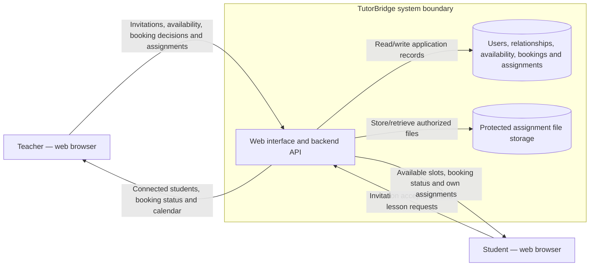

# TutorBridge — Project Proposal and System Vision & Boundary

**Course:** SENG 321  
**Deliverable:** Sprint 1 — Project Foundation  
**Status:** Draft for team review  
**Repository:** https://github.com/Sprint-1-Software-engineering/Sprint-1

This document develops the original project vision around the agreed MVP: managing existing teacher–student relationships, scheduling lessons, and sharing assignments. AI question generation and a parent dashboard are future features.

# Part I — Project Proposal

## 1. Problem Statement

Private tutors and their existing students may use separate messaging, calendar, and file-sharing tools to arrange lessons and exchange homework. This can fragment information: a schedule change may remain in a conversation, an assignment may be difficult to locate, and a student's access to learning materials may not be clearly organized.

TutorBridge addresses this coordination problem through a shared workspace for each teacher and their connected students.

**Evidence status:** These statements are problem hypotheses based on the proposed workflow. The supplied project files contain no documented interviews, survey results, or measured outcomes. The team should validate the problem with actual teachers and students and record the date, method, and findings. No empirical results are claimed here.

## 2. Target Users and Stakeholders

| Stakeholder | Needs and interests |
|---|---|
| Private tutor / teacher | Manage existing student relationships, publish available lesson slots, handle lesson requests, and assign learning materials. |
| Student | Connect with their teacher, request an available lesson, view booking status, and access their own assignments. |
| Development team | Maintain a consistent and feasible scope, implement and test the workflows, and document contributions. |
| Application operator | Maintain application availability, storage, configuration, and access controls. This is an operational responsibility, not a proposed MVP administrator dashboard. |
| Infrastructure provider, if selected | Supply application hosting and storage under the chosen deployment arrangement. No provider has been selected in the supplied materials. |

Parents are potential stakeholders for a future version; they are not MVP application users.

## 3. Proposed Solution

TutorBridge is a web application for teachers and students who already have a tutoring relationship. It supports three connected workflows:

1. **Teacher–student connection:** A teacher creates an invitation. A student accepts a valid invitation, establishing a relationship used by the access-control rules.
2. **Lesson scheduling:** A teacher publishes available slots. A connected student requests a slot. The teacher approves or rejects the request, and participants can view their own lesson calendar and cancel permitted bookings.
3. **Assignment sharing:** A teacher uploads a PDF or image and assigns it to a connected student. The student can view and download materials assigned to them.

The platform is intended to organize an existing tutoring practice. Teacher discovery, matching, and payment processing are outside the first release.

## 4. Expected Benefits and Proposed Success Criteria

Expected benefits include a single place to find lesson details and assignments, clearer booking status, and reduced manual coordination. These are intended benefits, not measured results.

The following are proposed acceptance targets for team review:

| Area | Proposed measurable target |
|---|---|
| Booking workflow | A connected student who is already logged in can submit a request for an available slot within two minutes in a representative usability task. |
| Conflict prevention | Automated tests show that two overlapping bookings cannot both become approved for the same teacher, including concurrent approval attempts. |
| Access control | Tests reject access to another student's private assignments and a teacher's unrelated records. |
| Assignment sharing | A teacher can upload a permitted PDF/image, assign it to a connected student, and the student can retrieve it in an end-to-end test. |
| Calendar consistency | Approved, rejected, and cancelled states are reflected in the participants' lesson lists after the relevant action completes. |

No tests or usability measurements are claimed as completed in Sprint 1.

## 5. Feasibility Assessment

### Technical feasibility

The proposed architecture consists of a web client, a backend API, persistent storage for users and bookings, and controlled storage for assignment files. The core workflows are conventional authenticated data-management operations. A maintained authentication solution and database transactions can support identity management and conflict prevention, but these capabilities must be implemented and tested.

The exact frameworks, database, authentication mechanism, and deployment provider have not been established in the supplied files. The team must record its selections and justify them against its skills and course constraints before implementation. This draft does not treat a technology proposal as an implemented system.

### Schedule and team feasibility

The team contains six students. Focusing on three workflows limits integration work and avoids adding an AI provider, payments, video infrastructure, and a third user role to the MVP. Actual capacity, estimates, dependencies, and ownership must be recorded in the initial product backlog and RACI matrix. Course deadlines must be taken from Teams and the official assignment; this draft does not invent dates.

### Cost and operational feasibility

No paid external AI service is needed for the agreed MVP. Hosting and file storage may incur costs depending on the selected deployment. A feasible initial environment should support a small evaluation dataset, bounded uploads, and a reproducible application setup. Provider quotas, expected storage, and any budget remain decisions for the team to verify.

### Validation still required

The team should validate the user problem, choose the technology stack and deployment arrangement, test the concurrency approach, and agree upload limits. These are outstanding feasibility checks rather than completed evidence.

## 6. MVP Scope

### Included

- Teacher and student registration and login.
- Teacher-created invitations and student acceptance.
- Listing the students connected to a teacher.
- Creating, listing, and removing teacher availability, subject to booking rules.
- Requesting a lesson and approving, rejecting, or cancelling an authorized booking.
- Viewing each participant's own lessons and their statuses.
- Uploading PDF/image assignment materials and assigning them to a connected student.
- Viewing and downloading authorized assignment materials.
- Enforcing authentication, role checks, and teacher–student relationship checks.

### Excluded from the MVP

- AI-generated questions or automatic AI tutoring.
- Parent accounts, parent feedback, and parent progress dashboards.
- Public teacher discovery and matching.
- Online payments and billing.
- Built-in video conferencing and real-time chat.
- External calendar synchronization.
- Native mobile applications.
- Advanced grading and learning analytics.
- Student homework submission and teacher feedback workflows; these may be prioritized for a later release.

## 7. Assumptions

- Teachers bring their existing students to the platform rather than acquiring them through a marketplace.
- Users can access a supported web browser and an internet connection.
- Each booking has a defined start and end time; stored and exchanged timestamps include an explicit time-zone convention.
- A student may be connected to more than one teacher; access is evaluated per relationship.
- Initial course evaluation uses a small dataset and controlled assignment uploads; production-scale capacity is not claimed.
- The team will use test or appropriately authorized data for demonstrations.

These assumptions must be reviewed with the stakeholders and reflected in the backlog and API design.

## 8. Risks and Mitigations

| Risk | Consequence | Proposed mitigation | Ownership to assign in RACI |
|---|---|---|---|
| Concurrent booking approvals | Overlapping approved lessons | Enforce the conflict rule transactionally and test concurrent requests. | Backend owner and QA reviewer |
| Incorrect relationship or role checks | Unauthorized disclosure or modification | Check role and relationship on the server for every protected operation; include negative authorization tests. | Backend owner and QA reviewer |
| Unsafe or excessive uploads | Storage exhaustion or unsafe file access | Restrict file types and sizes, generate storage identifiers, and authorize retrieval. Exact limits require agreement. | Assignment/API owner |
| Scope growth | Incomplete core workflows | Keep AI, parent access, payments, and advanced analytics outside the MVP; prioritize backlog dependencies. | Scope/backlog owner |
| Team integration and uneven workload | Late defects and unclear contributions | Assign deliverables, use Issues and reviewed PRs, and record actual contribution links. | Workflow owner and all members |
| Time-zone inconsistencies | Incorrect lesson times | Define timestamp conventions in the API and test displayed times. | Scheduling owner and QA reviewer |
| Hosting/storage constraints | Unavailable evaluation environment | Verify quotas, bound test data, and document a reproducible local setup. | Deployment/workflow owner |

Role descriptions here identify work that needs ownership. They do not claim that particular students have accepted those responsibilities; the team must map them to named members in RACI.

## 9. Open-Source License

The repository uses the MIT License. The proposed rationale is to allow straightforward reuse, modification, and redistribution of the project code while retaining the required copyright and license notice. The team must review dependency licenses when selecting its implementation stack.

Code licensing, repository visibility, and access to user data are separate decisions. Choosing MIT does not make student records or assignment content public. The repository's existing license file remains the source of the license text.

# Part II — System Vision & Boundary

## 10. System Vision

TutorBridge provides a shared web workspace in which private tutors organize lessons and assignments for their existing students. It aims to make each student's next lesson and assigned learning materials easy to find while giving teachers control over relationships, availability, booking decisions, and assignment access.

## 11. Actors and Core Workflows

| Actor | System interactions |
|---|---|
| Teacher | Authenticate; invite students; view connected students; manage availability; review lesson requests; view/cancel permitted lessons; upload and assign materials. |
| Student | Authenticate; accept invitations; view connected teachers' availability; request/cancel permitted lessons; view their own bookings and assignments. |

The application operator maintains the deployment. Operational maintenance does not require an additional MVP product role or dashboard.

## 12. System Responsibilities

The TutorBridge boundary includes:

- The application interface and backend API.
- Authentication and authorization enforcement, using the team's chosen implementation.
- Invitation and teacher–student relationship records.
- Availability, lesson requests, state transitions, and conflict prevention.
- Assignment metadata and controlled access to assignment files.
- Application-managed persistence and storage responsibilities.

The system is responsible for validating requests and enforcing access rules. A client interface hiding a control is not sufficient authorization.

## 13. Responsibilities Outside the Boundary

- Users decide lesson suitability and what learning materials to share.
- Teachers conduct the lessons and provide academic instruction outside the application.
- Payment collection, live lesson delivery, AI-generated content, parent monitoring, and third-party calendar synchronization are outside the MVP.
- Infrastructure operation may be supplied by a hosting provider; no external runtime provider or integration has yet been selected in the supplied documents.

## 14. Context and Boundary Diagram

The following diagram shows logical responsibilities, not a finalized deployment. The web browsers and human actors are outside the TutorBridge service boundary. Persistent data and file storage are application-managed resources; a hosting vendor's physical infrastructure would remain outside the team's operational control.

There is no required external application-to-application integration in the agreed MVP. If the team later selects hosted authentication, object storage, or notification delivery, it must update this diagram and describe the provider boundary, data exchanged, and failure handling. GitHub and Teams support development/submission; they are not runtime tutoring-system integrations.

## 15. Proposed Business Rules

These rules are a proposed specification for team review and must be kept consistent with the OpenAPI contract and backlog acceptance criteria.

1. Only authenticated users may access protected resources; invitation acceptance requires an authenticated student.
2. An invitation creates a teacher–student relationship only when it is valid and accepted. Expiry and reuse rules must be finalized in the API/backlog.
3. A student may request a lesson only from a teacher with whom they have an active relationship.
4. Requested start/end times must be valid and contained within the teacher's available time. End time must be after start time.
5. A new booking request starts as `pending`. The relevant teacher may approve or reject it.
6. Two overlapping bookings for the same teacher must not both become approved, including when approvals happen concurrently.
7. **Proposed pending policy:** A pending request does not reserve the slot exclusively. Approval rechecks availability and conflicts; competing requests cannot create overlapping approved lessons. The team must confirm this policy.
8. A teacher manages only their own availability, connected students, bookings, and assignments.
9. A student can retrieve only assignments addressed to them. File access must obey the same rule as assignment metadata access.
10. **Proposed cancellation policy:** Either participant may cancel their own pending or approved booking before its start time. Unrelated users cannot change it. Any different deadline or rule must be agreed and documented consistently.
11. Approved bookings must not silently disappear when availability is changed. The change must be rejected or the permitted cancellation process applied explicitly.
12. Timestamp representation and display conventions must be stated in the OpenAPI contract. The API must not rely on an ambiguous local time without a time-zone convention.

## 16. Remaining Sprint 1 Alignment Work

- Confirm the proposed business policies, technology choices, success targets, and named ownership with the team.
- Complete `Team-Members-and-RACI.md` for the six Sprint 1 deliverables and peer-review responsibilities.
- Replace the empty OpenAPI path entries with validated operations, schemas, and errors for the agreed MVP; move AI and parent APIs outside the first-release contract.
- Create the initial Epic–Feature–Story–Task backlog with priorities, acceptance criteria, estimates, dependencies, and assignees.
- Maintain a separate `CONTRIBUTIONS.md` with actual Issue, PR, and commit evidence for each member.
- Validate this draft against the official Project Foundation PDF and Examples file, which were not available for this review.
- Complete the repository workflow, effective branch protections, peer reviews, Sprint 1 release tag, evaluator access, and Teams ZIP/repository-link submission requirements.

The existence of this draft does not mark those outstanding tasks as completed.
