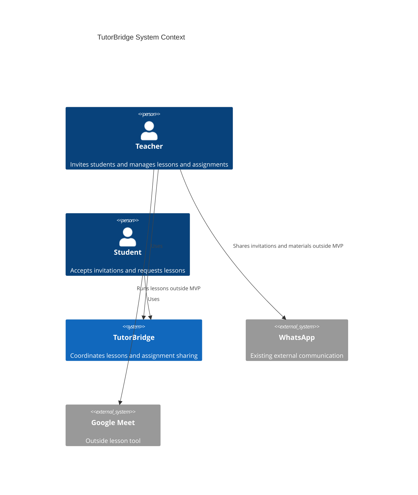
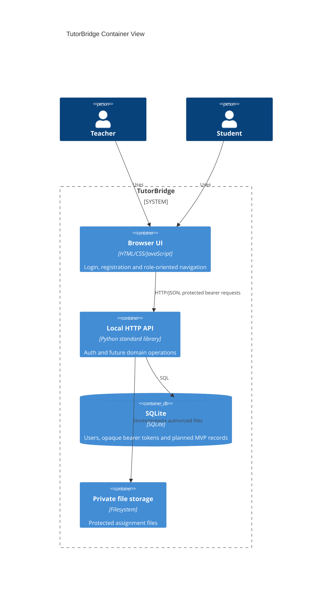
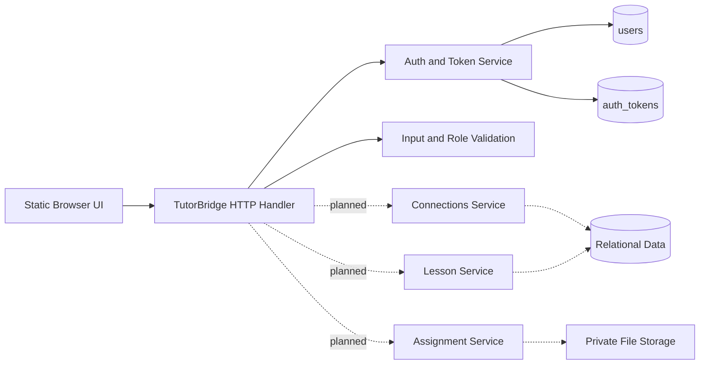
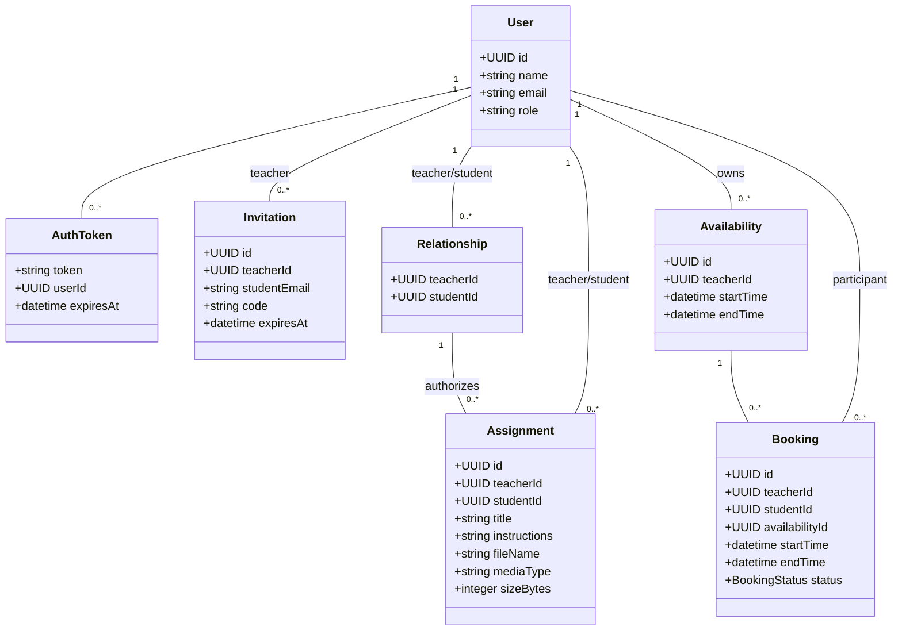
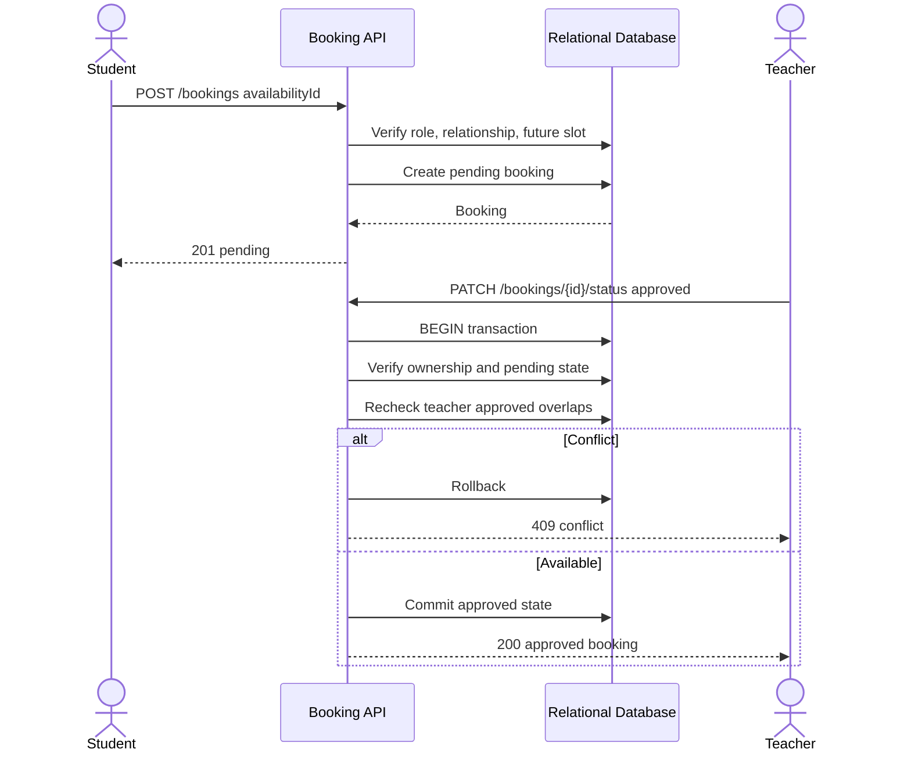

# TutorBridge Sprint 2 Architecture

Status: design baseline with one implemented authentication slice. This document separates observed code from proposed work. It is not a claim that the complete MVP, deployment or team-wide technology choice has been approved.

## 1. Scope and technology status

The repository currently contains a local Python standard-library HTTP server, SQLite persistence, static HTML/CSS/JavaScript screens and an example student dashboard.

| Area | Applied now | Planned / unresolved |
|---|---|---|
| Browser | Static login, registration and sample dashboard files | Role-specific production journeys and Figma implementation |
| API | `/api/v1/auth/register`, `/api/v1/auth/login`, `/api/v1/users/me` local handlers | Invitations, availability, bookings and assignment operations |
| Auth | 12-128 character password, PBKDF2-SHA256 hash, random opaque bearer token, SQLite `auth_tokens`, one-hour expiry | JWT alternative, logout/revocation UI, concurrency policy |
| Data | `users` and `auth_tokens` SQLite tables | Invitations, relationships, availability, bookings, assignments and private file storage |
| Deployment | Local server at `127.0.0.1:8000` | Hosting, HTTPS, backup and CI/deployment decision; coordinate with Osman |

Python/SQLite is currently the implemented and least-disruptive baseline. Node.js/Express remains an earlier draft alternative, not an active implementation. The team must record one approved backend direction before architecture sign-off.

## 2. Architecture style

The implemented slice is a modular monolith: static browser assets, HTTP request handling, SQLite access and password/token services are separated at module boundaries even though they run in one Python process.

The target MVP keeps HTTP boundaries stable and isolates domain behavior behind server-side services:

- **Presentation:** static/browser UI and future role-specific pages.
- **HTTP API:** validation, authentication, role/relationship authorization and response codes.
- **Domain services:** invitations/connections, availability, booking lifecycle and assignment access.
- **Persistence:** SQLite now or an approved relational database with foreign keys and transactions.
- **Protected file storage:** private storage outside public static files.

Caller-supplied identity must not select a user or bypass server ownership checks.

## 3. C4 context

## 4. C4 container

## 5. Component view

The implemented auth path is `TutorBridgeHandler -> validation -> SQLite -> auth_tokens/users`. Planned domain components have no implementation evidence.

## 6. Domain model

## 7. Database design

### Implemented SQLite tables

`users`

| Column | Rule |
|---|---|
| `id` | Text UUID primary key |
| `name` | Not null, 1-100 characters at application boundary |
| `email` | Normalized unique non-null text |
| `password_hash` | PBKDF2-SHA256 string; never returned |
| `role` | Check constraint: `teacher` or `student` |
| `created_at` | UTC ISO-8601 text |

`auth_tokens`

| Column | Rule |
|---|---|
| `token` | Random opaque bearer token, primary key |
| `user_id` | Foreign key to `users(id)` with cascade delete |
| `expires_at` | UTC ISO-8601 text; valid only while it is later than the server clock |

### Planned relational tables

- `invitations`: unique id, teacher foreign key, normalized student email, private code, expiry, used state.
- `relationships`: teacher/student foreign-key pair with a unique pair constraint.
- `availability`: UUID, teacher foreign key, offset-aware UTC start/end; overlap and ownership checks in transactions.
- `bookings`: UUID, teacher/student/availability foreign keys, copied UTC times and status. Approval conflicts use `startTime < otherEnd && endTime > otherStart`.
- `assignments`: UUID, teacher/student foreign keys, title, instructions and file metadata.
- `assignment_files`: opaque storage reference, safe name, actual media type and size; not a public URL.

Use database transactions for invitation consumption/relationship creation and booking approval/conflict checks. Store UUIDs and offset-aware times according to the OpenAPI data types; persist instants in UTC.

## 8. Booking approval sequence

## 9. Interfaces and decisions

- OpenAPI 3.0.3 is the contract baseline. The local auth server currently exposes `/api/v1/auth/register`, `/api/v1/auth/login` and `/api/v1/users/me` on `127.0.0.1:8000`.
- JSON registration rejects null, arrays, objects, unknown properties and invalid values instead of coercing them.
- Registration requires 12-128 characters and a syntactically valid email. Login uses submitted credentials and generic failure response.
- The implemented random bearer token is opaque and database-backed. JWT would be an explicit alternative and requires team approval plus contract/library changes.
- Assignment 404 means the referenced student or assignment resource is unknown where the operation documents that resource.
- Cross-teacher student conflicts, pagination, hosting, retention and deployment remain open decisions.

Editable Mermaid sources and rendered SVG outputs are linked in the rendered-diagrams section below.

## 10. Rendered diagrams

- [Context diagram SVG](../diagrams/TutorBridge-context.svg)
- [Container diagram SVG](../diagrams/TutorBridge-container.svg)
- [Domain diagram SVG](../diagrams/TutorBridge-domain.svg)
- [Booking approval sequence SVG](../diagrams/TutorBridge-booking-sequence.svg)
