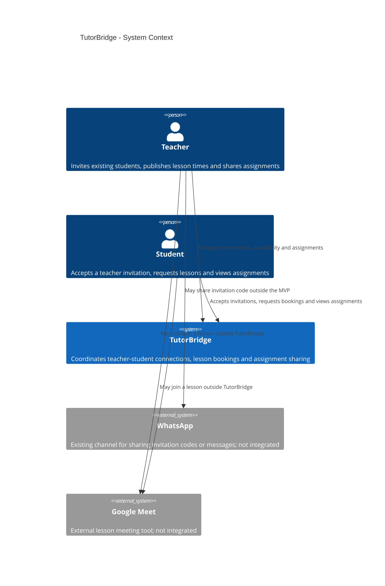
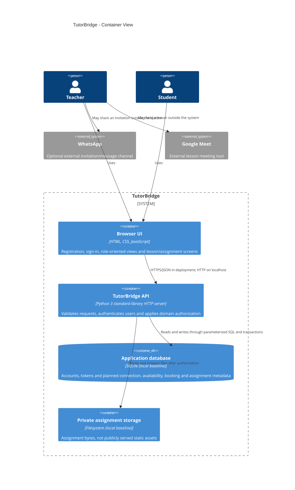
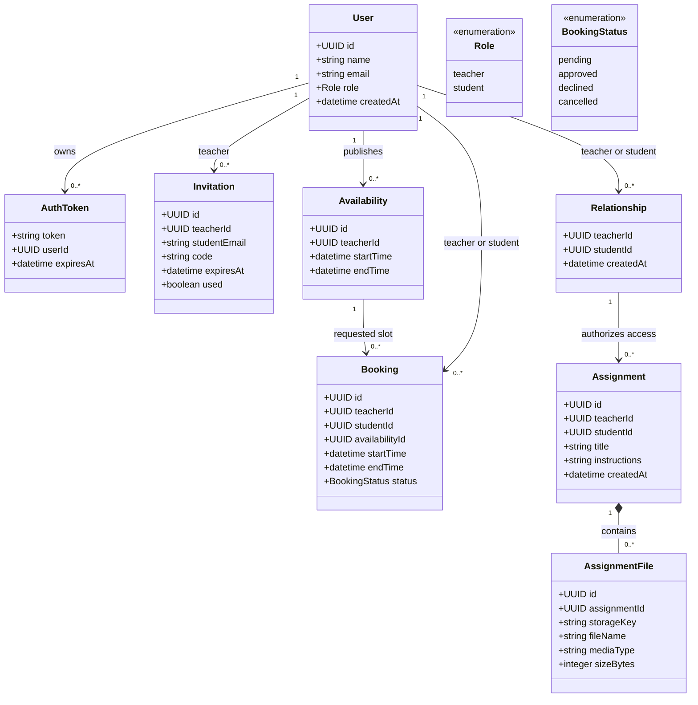
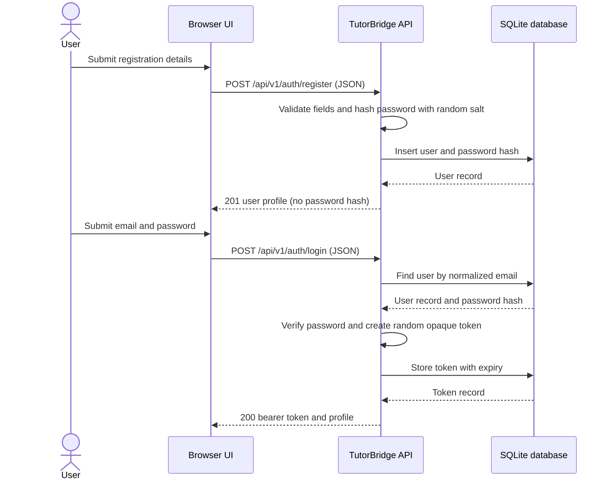

# TutorBridge Sprint 2 Architecture

Status: architecture proposal for peer review. The diagrams describe the Sprint 2 MVP target, not a fully implemented or team-approved production system. PR #58 is the reference for the local authentication prototype; invitations, bookings, assignments and deployment remain design scope.

## 1. Technology choices and rationale

| Concern | Proposed choice | Why it fits the current scope | Trade-off / decision status |
|---|---|---|---|
| Browser UI | HTML, CSS and JavaScript | The prototype uses static pages and needs no build pipeline or client framework for the current forms and dashboard. | More complex interactive screens may justify a framework later; no framework is selected here. |
| API | Python 3 standard library HTTP server, with REST/JSON boundaries | The reference authentication slice demonstrates this approach without a third-party runtime dependency. It is straightforward to run locally and keeps the MVP as one deployable application. | The standard-library server is a prototype baseline, not a production hosting recommendation. Node.js/Express appeared in earlier drafts; the team must approve one backend direction before implementation expands. |
| Architecture style | Modular monolith | Authentication, connection, scheduling and assignment features can share one process and relational database while keeping domain responsibilities separate. It avoids distributed-service overhead for a small team and an early MVP. | Service extraction can be reconsidered only if scale or ownership needs justify its operational cost. |
| API contract | OpenAPI 3.0.3; HTTP with JSON | OpenAPI documents request/response shapes and status codes independently of the chosen backend language, and provides a stable boundary for the browser and later tests. | The OpenAPI file is a design contract; endpoints other than the prototype auth slice are not implemented. |
| Persistence | SQLite for local development and the initial single-instance prototype | It requires no separate database service, supports transactions and foreign keys, and is available with Python's standard library. That reduces setup work while the data model is small. | SQLite is not a decision for a concurrent hosted deployment. Reassess a managed relational database before production based on write concurrency, availability, backup and operations requirements. |
| Authentication | Opaque random bearer token stored server-side with an expiry | The reference implementation can invalidate a session by deleting its record, without introducing JWT signing keys or refresh-token machinery. | Each authenticated request needs a token lookup; no logout/revocation endpoint is currently implemented, and cleanup policy remains to be designed. JWT is an alternative only if stateless verification becomes a real requirement. |
| Password storage | PBKDF2-HMAC-SHA256 with a per-password random salt | It uses Python's standard library and avoids storing plaintext passwords or adding a password-hashing package to the prototype. | Production parameters and rate limiting need security review and operational calibration before launch. |
| Diagram source | Mermaid (`.mmd`) | Plain-text sources can be reviewed and edited in Git alongside the architecture document without a proprietary design tool. | Keep these sources in sync with the Markdown previews when the design changes. |

These are scope-based recommendations, not evidence that the team has approved the production stack. In particular, backend runtime, hosted database, deployment target, token policy and file storage still need owner decisions.

## 2. Architecture style and boundaries

The proposed MVP is a modular monolith with the following responsibilities:

- **Browser UI:** role-oriented views and input collection; it does not decide the caller's identity or authorize access.
- **HTTP/API layer:** JSON validation, authentication, role checks and mapping domain outcomes to HTTP status codes.
- **Domain services:** invitations and relationships, availability and booking lifecycle, and assignment metadata/access.
- **Persistence:** relational records with foreign keys and transactions for one-time invitation consumption and booking conflict checks.
- **Private file storage:** assignment file bytes outside the public static-file directory; the API authorizes every upload and download.

The bearer token, not a caller-supplied user ID, identifies the authenticated account. The server checks teacher/student roles, relationship ownership and resource ownership before returning or changing private data.

## 3. C4 System Context

TutorBridge connects teachers and their existing students. WhatsApp and Google Meet are shown as external systems used outside the MVP, not integrations built by TutorBridge.

Editable source: [TutorBridge-context.mmd](../diagrams/TutorBridge-context.mmd).



## 4. C4 Container

The browser and API communicate over HTTP/JSON. The API owns authorization and is the only container allowed to access the database and private assignment files. The SQLite and filesystem choices describe the local/single-instance baseline, not an approved hosted topology.

Editable source: [TutorBridge-container.mmd](../diagrams/TutorBridge-container.mmd).



## 5. UML domain class diagram

This is the proposed domain model, not a claim that all entities already exist in the database. `User` and `AuthToken` correspond to the authentication prototype; the remaining classes are planned MVP data. A relationship links one teacher and one student; an assignment is accessible only to the connected pair.

Editable source: [TutorBridge-domain.mmd](../diagrams/TutorBridge-domain.mmd).



## 6. Sequence: register and sign in

This sequence captures the authentication behavior used by the local prototype reference. Registration stores a password hash; sign-in returns an opaque token that the server records with an expiry. The browser never receives the stored password hash.

Editable source: [TutorBridge-auth-sequence.mmd](../diagrams/TutorBridge-auth-sequence.mmd).



## 7. Sequence: request and approve a lesson

The student can request a future slot only through an authorized teacher-student relationship. Approval rechecks overlap inside a transaction so two requests cannot both reserve a conflicting teacher time.

Editable source: [TutorBridge-booking-sequence.mmd](../diagrams/TutorBridge-booking-sequence.mmd).

```mermaid
sequenceDiagram
  actor Student
  participant API as TutorBridge API
  participant DB as Relational database
  Student->>API: POST /bookings (availabilityId), bearer token
  API->>API: Authenticate student and validate request
  API->>DB: Verify relationship, slot ownership and future time
  API->>DB: Create pending booking
  DB-->>API: Pending booking
  API-->>Student: 201 pending booking
  actor Teacher
  Teacher->>API: PATCH /bookings/{id}/status (approved), bearer token
  API->>API: Authenticate teacher
  API->>DB: BEGIN transaction; verify booking ownership and pending state
  API->>DB: Check for overlapping approved bookings
  alt Conflict exists
    API->>DB: ROLLBACK
    API-->>Teacher: 409 conflict
  else No conflict
    API->>DB: Update status and COMMIT
    DB-->>API: Approved booking
    API-->>Teacher: 200 approved booking
  end
```

## 8. Data and API constraints

### Authentication tables in the prototype reference

| Table | Important fields and rules |
|---|---|
| `users` | UUID text primary key, required name, normalized unique email, password hash, `teacher`/`student` role constraint and UTC creation time. |
| `auth_tokens` | Opaque token primary key, `user_id` foreign key with cascade delete, expiry timestamp and an index by user. |

### Planned MVP entities

- `invitations`: teacher, normalized student email, single-use code, expiry and used state. Consume the invitation and create the relationship atomically.
- `relationships`: teacher/student foreign keys with a unique pair constraint.
- `availability`: teacher foreign key and timezone-aware interval; reject invalid or overlapping intervals.
- `bookings`: student, teacher and availability references, copied UTC start/end and lifecycle status. On approval, detect overlap using `startTime < otherEnd && endTime > otherStart` within a transaction.
- `assignments` and `assignment_files`: teacher/student scope, instructions and private storage metadata. Never expose a filesystem path or public static URL.

The OpenAPI draft is the interface contract for these future operations. It still specifies `localhost:3000` and JWT, while the local prototype reference uses `127.0.0.1:8000` and opaque database-backed tokens; resolve this mismatch with the SRS owners before changing either contract. Persist instants in UTC, retain offset-aware input validation, use foreign keys and parameterized queries, and return a resource only after checking the caller's role and ownership. Only registration, login and current-user lookup are represented as implemented in the prototype reference; the remaining API operations are planned.

## 9. Open decisions and links

- Confirm Python/standard-library HTTP versus Node.js/Express with the team before implementation expands.
- Confirm whether SQLite remains appropriate for the hosted deployment; select backup, recovery and migration practices with the deployment owner.
- Confirm token lifetime, logout/revocation behavior, cleanup, rate limiting and production password-hash parameters.
- Decide hosting, HTTPS termination, private file storage and operational monitoring.
- Align the API contract, implementation, local run instructions and UI ports when the backend direction is approved.

Related references: [OpenAPI draft](../Openapi.yaml), [deployment and recovery handoff](Deployment-and-Recovery.md), [local development and delivery](Local-Development-and-Delivery.md).
